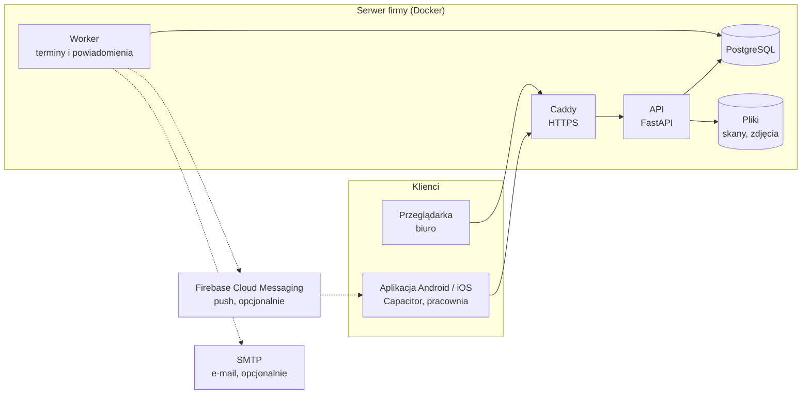
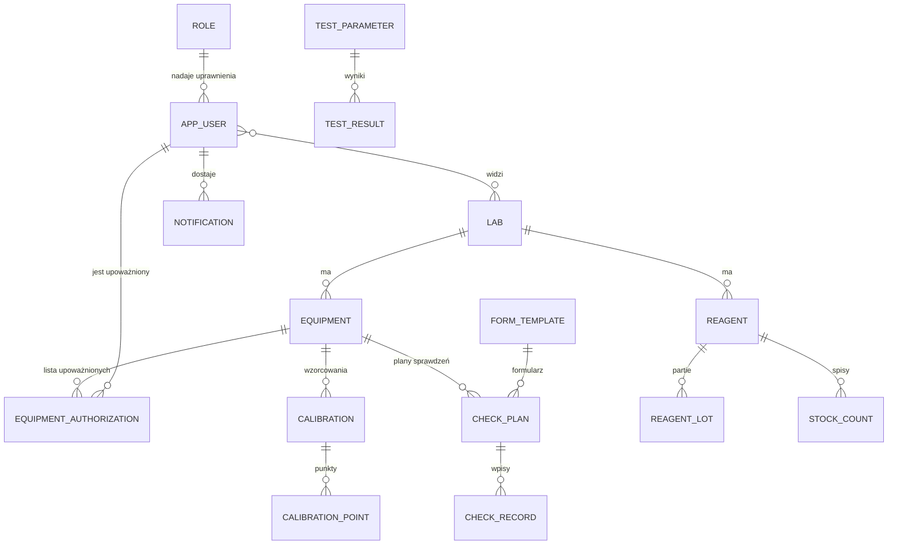
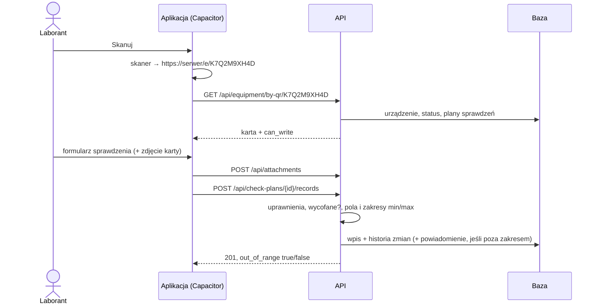
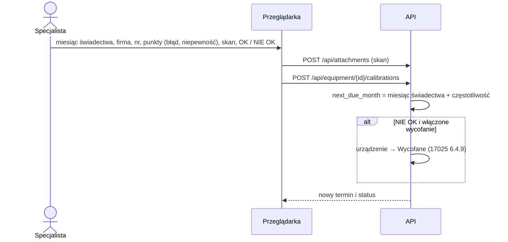
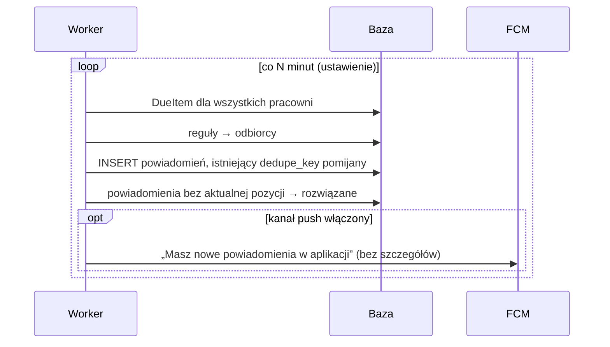

# 02 — Architektura

Wymagania: [01-zadanie.md](01-zadanie.md). Research i uzasadnienia: [04-research.md](04-research.md).
Plan prac: [03-implemetacja.md](03-implemetacja.md).

Oznaczenia: **[T]** — decyzja zespołu; **propozycja** — decyzja architektury, którą zespół
może zmienić. F1–F9 to funkcje z tabeli w 01 §3.3.

---

## 1. Decyzje w skrócie

| # | Decyzja | Dlaczego | Status |
|---|---|---|---|
| D1 | Własna aplikacja, nie gotowy LIMS ani ERPNext | gotowe systemy są szersze niż potrzeba, ceny tylko na zapytanie, żaden darmowy nie ma wszystkiego (04 §4) | [T] |
| D2 | Backend: Python + FastAPI + PostgreSQL | wybór zespołu; FastAPI generuje opis API (OpenAPI), z którego frontend generuje typy | [T] |
| D3 | Jeden frontend React dla przeglądarki i telefonów; na Androida i iOS zamknięty w Capacitor od początku | wybór zespołu; jeden kod interfejsu, natywny skaner, aparat i push | [T] |
| D4 | Jedna instalacja = jedna firma; różnice między firmami tylko w konfiguracji | serwer może stać w zakładzie (cyberbezpieczeństwo, pyt. 13 w 01); prostszy model danych niż wiele firm w jednej bazie | propozycja |
| D5 | Terminy i statusy liczone z danych, nie wpisywane | status zawsze aktualny; nie ma drugiego miejsca, które może się rozjechać | propozycja |
| D6 | Każda zmiana zapisu i konfiguracji trafia do historii (kto, kiedy, co było, co jest) | 17025 pkt 7.5.2 i 7.11.2 | propozycja |
| D7 | Liczby pomiarowe jako `Decimal` / `NUMERIC`, nigdy `float`; na wejściu przecinek albo kropka | zakresy typu 0,005–0,105 %; polskie przyzwyczajenie do przecinka | propozycja |
| D8 | Logowanie tokenem sesji (nagłówek `Authorization: Bearer`), w bazie tylko skrót tokenu; hasła Argon2 | aplikacja Capacitor ma inny origin niż serwer, więc ciasteczka są zawodne; sesję można od razu unieważnić (zgubiony telefon, odebrane uprawnienia) | propozycja |
| D9 | Powiadomienia o terminach liczy osobny proces (worker), bez duplikatów | powiadomienie ma historię (przeczytane, rozwiązane); ponowne uruchomienie niczego nie dubluje | propozycja |
| D10 | QR zawiera link `https://<serwer>/e/<public_id>` | aparat systemowy otworzy link w przeglądarce, skaner w aplikacji wyciągnie ID; kod `121/A` się nie nadaje (ma „/”, numery powtarzają się między pracowniami) | propozycja |
| D11 | Adres serwera ustawiany w aplikacji mobilnej przy pierwszym uruchomieniu | jedna aplikacja w sklepie, wiele firm, każda z własnym serwerem (D4) | propozycja |

---

## 2. Widok ogólny



| Komponent | Technologia | Odpowiada za |
|---|---|---|
| Frontend | React + TypeScript + Vite, MUI, TanStack Query | ekrany biura i pracowni — jeden kod |
| Aplikacja mobilna | Capacitor 8 + pluginy: skaner kodów, aparat, push | ten sam frontend na Androidzie i iOS |
| API | FastAPI, SQLAlchemy 2, Alembic, Pydantic v2 | logika, uprawnienia, historia zmian, pliki |
| Worker | ten sam kod Pythona, osobny proces | przeliczanie terminów, powiadomienia, wysyłka push i e-mail |
| Baza | PostgreSQL 16+ | dane i historia zmian |
| Pliki | wolumen dyskowy | skany świadectw, zdjęcia kart |
| Proxy | Caddy | HTTPS, serwowanie frontendu, `/api` → API |

---

## 3. Model danych

### 3.1 Encje i relacje



### 3.2 Pola

| Encja (tabela) | Najważniejsze pola | Skąd |
|---|---|---|
| `Lab` (`lab`) | `name`, `code` (litera, np. `A`, unikalna), `active` | 01 §2.1 |
| `Role` (`role`) | `name`, `permissions` (lista, §5) | 01 §3.2 |
| `User` (`app_user` — `user` jest zarezerwowane w PostgreSQL) | `login`, `full_name`, `password_hash`, `role_id`, `all_labs`, zakres pracowni (`user_lab`), `active` | 01 §3.2 |
| `UserSession` (`user_session` — nazwa `Session` koliduje z sesją SQLAlchemy) | `user_id`, `token_hash`, `expires_at`, `revoked_at`, `device_info` | D8 |
| `Equipment` (`equipment`) | `public_id` (do QR), `lab_id`, `number` → kod `121/A`; `name`, `category`, `manufacturer`, `model`, `serial_no`, `software_version`, `location`; `calibration_required`, `calibration_interval_months`, `calibration_mode` (`EXTERNAL` / `ON_SITE`), `lead_months`, `acceptance_criteria`; `withdrawn_at`, `withdrawn_reason`; `notes` | F1, 17025 6.4.13 |
| `EquipmentAuthorization` | `equipment_id`, `user_id` | F7 |
| `Calibration` | `equipment_id`, `calibrated_month` (ze świadectwa), `vendor`, `certificate_no`, `adjustments`, `result` (`OK` / `NOK` — decyzja admina), `next_due_month` (kopia na pamiątkę), `note`, załączniki | F4, 6.4.13 e |
| `CalibrationPoint` | `calibration_id`, `point` (np. „500 g”), `error`, `uncertainty`, `unit` | F4 („punkty wzorcowania” z rozmowy) |
| `FormTemplate` | `name`, `fields`: lista `{key, label, type: number/text/bool/date, unit, min, max, required}` | 01 §3.1 (pola konfigurowalne) |
| `CheckPlan` | `equipment_id`, `name` (np. „Sprawdzenie temperatury”, „Konserwacja”), `interval_months`, `lead_months`, `form_template_id`, `active` | F5, 6.4.10, 6.4.13 g |
| `CheckRecord` | `check_plan_id`, `performed_on`, `values` (JSON), `out_of_range`, `performed_by`, załączniki | F5 |
| `Reagent` | `lab_id`, `name`, `kind` (`REAGENT` / `CRM`), `unit`, `min_stock`, `stock_count_interval_days`, `expiry_lead_months`, `active` | F8 |
| `ReagentLot` | `reagent_id`, `lot_no`, `expiry_date`, `quantity`, `received_on`, `disposed_on` | F8, 6.4.13 f |
| `StockCount` | `reagent_id`, `quantity`, `counted_on`, `counted_by` | F8 |
| `TestParameter` | `material`, `name`, `unit`, `min_value`, `max_value` (puste = bez zakresu), `method`, `accredited`, `out_of_range_action` (`FLAG` / `BLOCK`, puste = ustawienie ogólne), `active` | F9, 01 §4 |
| `TestResult` | `parameter_id`, `sample_label`, `value`, `min_snapshot`, `max_snapshot`, `in_range`, `repeat_of_id`, `created_by` | F9, 7.5.2 |
| `Notification` | `user_id`, `kind`, `ref_type`, `ref_id`, `title`, `due`, `dedupe_key`, `read_at`, `resolved_at`; unikalne `(user_id, dedupe_key)` | F3 |
| `NotificationRule` | `kind` → `recipients` (role, czy wg zakresu pracowni), `channels` (`IN_APP`, `PUSH`, `EMAIL`), `enabled` | F3, 01 §3.1 |
| `DeviceToken` | `user_id`, `platform`, `token` (FCM) | F3 (push) |
| `Attachment` | `owner_type`, `owner_id`, `lab_id` (do kontroli dostępu), `filename`, `content_type`, `size_bytes`, `sha256`, `storage_key`, `uploaded_by` | F4, F5 |
| `Setting` | `key` → `value` (JSON) | 01 §3.1 |
| `AuditLog` | `at`, `user_id`, `action` (`create` / `update` / `delete` / `reject` / `login`), `entity`, `entity_id`, `before`, `after`, `reason` | 7.5.2, 7.11.2 |

Zasady:

- Kod urządzenia: unikalna para `(lab_id, number)`, wyświetlany jako `{number}/{lab.code}`.
- Przy dodawaniu urządzenia można podać ostatnie wzorcowanie z naklejki (MM/RRRR). Powstaje
  wtedy pierwszy wpis wzorcowania z notatką „przeniesione z ewidencji papierowej” — tak
  przenosimy kilkaset pozycji z papieru bez wymyślania danych.
- Zapisów technicznych (wzorcowania, sprawdzenia, spisy, wyniki) nie usuwamy. Poprawka =
  edycja z powodem → historia.
- Miesiące w bazie jako `date` z 1. dniem miesiąca, w API jako `"YYYY-MM"`.
- Kolumny liczbowe jako `NUMERIC` bez skali (zachowuje zapis, np. `0.10`); w JSON liczby
  pomiarowe są tekstem (`"0.10"`), żeby nic nie zaokrągliło ich po drodze.

### 3.3 Pokrycie 17025 pkt 6.4.13

| Punkt | Pola |
|---|---|
| a) identyfikacja, oprogramowanie | `Equipment.name`, `category`, `software_version`, kod |
| b) producent, typ, nr seryjny | `manufacturer`, `model`, `serial_no` |
| c) dowód zgodności | `Calibration.result`, skan świadectwa, `acceptance_criteria` |
| d) lokalizacja | `lab_id`, `location` |
| e) wzorcowania, adiustacje, kryteria, termin lub interwał | `Calibration` + `CalibrationPoint`, `adjustments`, `calibration_interval_months`, liczony termin |
| f) materiały odniesienia | `Reagent` (`kind = CRM`), `ReagentLot.expiry_date`, załączniki |
| g) konserwacja | `CheckPlan` / `CheckRecord` (np. plan „Konserwacja”) |
| h) uszkodzenia, naprawy | tylko `withdrawn_reason` i `notes` — pełny dziennik napraw później |

---

## 4. Terminy i statusy (serce systemu)

### 4.1 Reguły

| Co | Termin | „Ważne do” | „Alert od” |
|---|---|---|---|
| Wzorcowanie | `calibrated_month + calibration_interval_months` | ostatni dzień miesiąca terminu | 1. dzień miesiąca `termin − lead_months` |
| Sprawdzenie | miesiąc ostatniego `performed_on` + `interval_months` | ostatni dzień miesiąca terminu | jak wyżej |
| Partia odczynnika / CRM | `expiry_date` | `expiry_date` | `expiry_date − expiry_lead_months` (dzień przycięty do końca miesiąca) |
| Stan odczynnika | — | — | `stan < min_stock`, gdzie `stan = ostatni spis + partie przyjęte po dniu spisu` |
| Spis stanu | — | — | ostatni spis starszy niż `stock_count_interval_days` |

Wyprzedzenie: urządzenia i partie 1–12 miesięcy (domyślnie 1), plany sprawdzeń 0–12
(domyślnie 0). Dlaczego 0 dla sprawdzeń: przy sprawdzeniu co miesiąc wyprzedzenie 1 mies.
dawałoby alert zaraz po wykonaniu. Granice są w ustawieniach.

Urządzenia wycofane nie generują alertów o terminach.

### 4.2 Statusy

| Status | Kiedy | Etykieta | Kolor |
|---|---|---|---|
| `OK` | dziś < alert od | Ważne | zielony |
| `DUE_SOON` | alert od ≤ dziś ≤ ważne do | Zbliża się termin | żółty |
| `OVERDUE` | dziś > ważne do | Po terminie | czerwony |
| `NO_DATA` | wymaga wzorcowania, brak wpisu | Brak danych | czerwony |
| `WITHDRAWN` | urządzenie wycofane | Wycofane | szary |
| `NOT_REQUIRED` | `calibration_required = false` | Bez wzorcowania | szary |
| `LOW` | stan odczynnika < próg | Mało | czerwony |
| `COUNT_DUE` | spis stanu zaległy | Zrób spis | żółty |

### 4.3 Przykłady (dziś = 27.11.2026)

| Przykład | Termin | Alert od | Ważne do | Status |
|---|---|---|---|---|
| Wzorcowanie 03/2026, co 12 mies., wyprzedzenie 1 | 03/2027 | 01.02.2027 | 31.03.2027 | `OK` |
| Wzorcowanie 12/2025, co 12 mies., wyprzedzenie 1 | 12/2026 | 01.11.2026 | 31.12.2026 | `DUE_SOON` |
| Wzorcowanie 10/2025, co 12 mies., wyprzedzenie 1 | 10/2026 | 01.09.2026 | 31.10.2026 | `OVERDUE` |
| CRM ważny do 31.05.2027, wyprzedzenie 6 | 31.05.2027 | 30.11.2026 | 31.05.2027 | `OK` (alert za 3 dni) |
| Sprawdzenie 05.11.2026, co 1 mies., wyprzedzenie 0 | 12/2026 | 01.12.2026 | 31.12.2026 | `OK` |

### 4.4 Harmonogram jako jedno źródło

Wszystkie terminy sprowadzamy do jednej struktury `DueItem` (`kind`, `ref_type`, `ref_id`,
`lab_id`, `label`, `due`, `alert_from`, `valid_until`, `status`). Korzystają z niej tabela
i grafik terminów (F2), powiadomienia (F3) i „Moje zadania” na telefonie.

Rodzaje (`kind`): `CALIBRATION`, `CHECK`, `LOT_EXPIRY`, `LOW_STOCK`, `STOCK_COUNT`.
`due` to termin (wzorcowanie, sprawdzenie, ważność), dla `LOW_STOCK` — dzień ostatniej zmiany
stanu (spis albo przyjęcie), dla `STOCK_COUNT` — dzień, od którego spis jest zaległy.

---

## 5. Uprawnienia

| Uprawnienie | Admin | Pracownik |
|---|---|---|
| `equipment:read`, `schedule:read`, `reagent:read`, `result:read` | ✓ | ✓ (swoje pracownie) |
| `equipment:write` (rejestr, upoważnienia, wycofanie) | ✓ | — |
| `calibration:write` | ✓ | — |
| `check:write` | ✓ | ✓, tylko gdy jest na liście upoważnionych |
| `reagent:write` (odczynniki, partie) | ✓ | — |
| `stock:write` (spis stanu) | ✓ | ✓ (swoje pracownie) |
| `result:write` | ✓ | ✓ |
| `settings:write`, `users:write`, `audit:read` | ✓ | — |

Zasady:

1. Zakres pracowni: `all_labs` albo lista pracowni użytkownika (konfigurowalne).
2. Upoważnić do urządzenia można tylko osobę, która ma tę pracownię w zakresie — pracownik
   jednej pracowni nie korzysta ze sprzętu innej (01 §2.1). Lista upoważnionych dotyczy osób
   bez `equipment:write`; admin może wpisać sprawdzenie zawsze (np. przenosząc zapisy z papieru).
3. Wycofane urządzenie nie przyjmuje wpisów sprawdzeń. Wzorcowanie (admin) można wpisać,
   ale przywrócenie do użytku to osobna akcja z powodem (17025 6.4.9).
4. Uprawnienia sprawdza API (warstwa serwisów), nie interfejs.
5. Nieupoważniony po skanie dostaje komunikat „Brak uprawnień do wpisu dla tego urządzenia”,
   bez formularza (F7).

Role i ich uprawnienia są danymi w bazie — tabela wyżej to ustawienie domyślne.

---

## 6. Konfiguracja (co można ustawić)

| Co | Gdzie | Domyślnie |
|---|---|---|
| Pracownie: nazwa, litera kodu | Ustawienia → Pracownie | z danych startowych |
| Użytkownicy: rola, zakres pracowni | Ustawienia → Użytkownicy | — |
| Częstotliwość wzorcowania, tryb, wyprzedzenie, kryteria akceptacji | karta urządzenia | wyprzedzenie 1 mies. |
| Plany sprawdzeń: cykl, wyprzedzenie, formularz | karta urządzenia | wyprzedzenie 0 |
| Pola formularzy (typ, jednostka, min, max, wymagane) | Ustawienia → Formularze | — |
| Próg minimalny, częstotliwość spisu, wyprzedzenie ważności | karta odczynnika | spis co 30 dni, wyprzedzenie 1 mies. |
| Parametry badań i zakresy | Ustawienia → Parametry (import CSV) | 25 wierszy z 01 §4 (wytrzymałości w kN i MPa osobno) |
| Reakcja na wynik poza zakresem | parametr albo ustawienie ogólne | `FLAG` — zapis z oznaczeniem i wymogiem powtórzenia |
| Wycofanie po wzorcowaniu „NIE OK” | ustawienie ogólne | włączone (17025 6.4.9; czekamy na pyt. 2 w 01) |
| Odbiorcy i kanały powiadomień | Ustawienia → Powiadomienia | tabela niżej, kanał: w aplikacji |
| Czas sesji, limit plików, cykl workera, limit prób logowania | ustawienia ogólne | 12 h, 10 MB, 60 min, 5 prób / 15 min |

Każda zmiana ustawień trafia do historii (17025 7.11.2).

Domyślne reguły powiadomień („admini pracowni” = admini, którzy mają tę pracownię w zakresie):

| Rodzaj | Odbiorcy | Kiedy |
|---|---|---|
| `CALIBRATION_DUE` | admini pracowni | `DUE_SOON`, `OVERDUE`, `NO_DATA` |
| `CHECK_DUE` | pracownicy i admini pracowni | `DUE_SOON`, `OVERDUE` |
| `LOT_EXPIRY` | admini pracowni | `DUE_SOON`, `OVERDUE` |
| `LOW_STOCK` | admini pracowni | `LOW` |
| `STOCK_COUNT_DUE` | pracownicy pracowni | `COUNT_DUE` |
| `CHECK_OUT_OF_RANGE` | admini pracowni | od razu przy wpisie |
| `RESULT_OUT_OF_RANGE` | admini | od razu przy wpisie |

---

## 7. API

REST pod `/api`, opis OpenAPI generowany przez FastAPI (`/api/openapi.json`).
Błędy zawsze w formacie `{"error": "<KOD>", "message": "<tekst po polsku>"}`.

| Obszar | Endpointy | Kto |
|---|---|---|
| Logowanie | `POST /auth/login`, `POST /auth/logout`, `GET /me` | wszyscy |
| Pracownie, użytkownicy, role | `GET/POST /labs`, `PATCH /labs/{id}`, `GET/POST /users`, `PATCH /users/{id}`, `GET /roles` | admin |
| Ustawienia | `GET/PUT /settings`, `GET/PUT /notification-rules`, `GET/POST /form-templates`, `PATCH /form-templates/{id}` | admin |
| Urządzenia | `GET/POST /equipment`, `GET/PATCH /equipment/{id}`, `GET /equipment/by-qr/{public_id}`, `POST /equipment/{id}/withdraw`, `POST /equipment/{id}/restore` | odczyt: wszyscy w zakresie; zmiany: admin |
| Upoważnienia | `GET/PUT /equipment/{id}/authorized-users` | admin |
| Wzorcowania | `GET/POST /equipment/{id}/calibrations` | zapis: admin |
| Sprawdzenia | `GET/POST /equipment/{id}/check-plans`, `PATCH /check-plans/{id}`, `GET/POST /check-plans/{id}/records` | plany: admin; wpisy: upoważnieni |
| Odczynniki | `GET/POST /reagents`, `PATCH /reagents/{id}`, `POST /reagents/{id}/lots`, `PATCH /lots/{id}`, `POST /reagents/{id}/stock-counts` | spis: pracownicy pracowni; reszta: admin |
| Wyniki | `GET/POST /test-parameters`, `PATCH /test-parameters/{id}`, `POST /test-parameters/import`, `GET/POST /test-results` | parametry: admin; wyniki: `result:write` |
| Harmonogram | `GET /schedule?lab_id=&kind=&horizon_months=&include_ok=` | wszyscy w zakresie |
| Powiadomienia | `GET /notifications?unread=`, `POST /notifications/{id}/read`, `POST /notifications/read-all`, `POST /devices` | zalogowani |
| Pliki | `POST /attachments`, `GET /attachments/{id}` | wg właściciela pliku |
| Historia | `GET /audit?entity=&entity_id=&from=&to=` | admin |
| Zdrowie | `GET /health` | publiczne |

Kody błędów:

| Kod | HTTP | Kiedy |
|---|---|---|
| `NOT_AUTHENTICATED` | 401 | brak, wygasły albo unieważniony token |
| `INVALID_CREDENTIALS` | 401 | zły login lub hasło, konto nieaktywne |
| `TOO_MANY_ATTEMPTS` | 429 | za dużo nieudanych logowań |
| `FORBIDDEN` | 403 | rola nie ma uprawnienia |
| `LAB_OUT_OF_SCOPE` | 403 | pracownia spoza zakresu użytkownika |
| `NOT_AUTHORIZED_FOR_EQUIPMENT` | 403 | brak na liście upoważnionych |
| `NOT_FOUND` | 404 | — |
| `EQUIPMENT_WITHDRAWN` | 409 | wpis sprawdzenia dla wycofanego urządzenia |
| `DUPLICATE_EQUIPMENT_NUMBER` | 409 | numer już jest w tej pracowni |
| `DUPLICATE_LAB_CODE` | 409 | litera pracowni już zajęta |
| `USER_NOT_IN_LAB` | 422 | upoważnienie dla osoby spoza pracowni |
| `INVALID_NUMBER` | 422 | liczby nie da się odczytać |
| `OUT_OF_RANGE` | 422 | wynik poza zakresem przy reakcji `BLOCK` |
| `VALIDATION_ERROR` | 422 | inne błędy danych (lista pól w `details`) |
| `FILE_TOO_LARGE` | 413 | — |
| `UNSUPPORTED_FILE_TYPE` | 415 | dozwolone: JPEG, PNG, PDF (rozpoznawane po zawartości, nie po nazwie) |

---

## 8. Najważniejsze przepływy

### 8.1 Skan QR → wpis sprawdzenia (F5, F6, F7)



Bez zalogowania: aplikacja pamięta adres `/e/...` i po zalogowaniu wraca na kartę urządzenia.

### 8.2 Wynik wzorcowania → nowy termin (F4)



### 8.3 Worker: terminy → powiadomienia (F3)



`dedupe_key = "{kind}:{ref_type}:{ref_id}:{due}:{status}"` — jedno powiadomienie na etap
(zbliża się, po terminie) dla każdej pozycji i odbiorcy. Nowe wzorcowanie zmienia `due`, więc
stary alert zostaje rozwiązany, a następny cykl dostaje nowy klucz. Zapis przez
`INSERT … ON CONFLICT DO NOTHING`, więc dwa workery naraz też nie zdublują powiadomień.
Powiadomienia „poza zakresem” tworzy API od razu, bez czekania na worker.

### 8.4 Wynik badania → kontrola zakresu (F9)

```mermaid
sequenceDiagram
  actor L as Laborant
  participant App
  participant API
  L->>App: parametr i wartość (np. SO₃ = 3,35)
  App->>API: POST /api/test-results
  API->>API: "3,35" → Decimal; zakres 0,10–3,20 → ABOVE
  alt reakcja BLOCK
    API->>API: próba zapisana w historii (reject)
    API-->>App: 422 OUT_OF_RANGE
  else reakcja FLAG
    API->>API: zapis z in_range = false i kopią zakresu, powiadomienie
    API-->>App: 201, wynik na czerwono, „powtórz badanie”
  end
```

---

## 9. Frontend i aplikacja mobilna

**Jeden kod, dwa układy**, wybierane po szerokości ekranu, nie po platformie:

- **Biuro** (szeroki ekran): menu boczne — Harmonogram, Urządzenia, Odczynniki, Wyniki,
  Powiadomienia, Ustawienia, Historia zmian.
- **Pracownia** (telefon): dolny pasek — Skanuj, Moje zadania, Spis odczynników, Powiadomienia.

| Potrzeba | Biblioteka |
|---|---|
| Routing | React Router |
| Dane z API, odświeżanie | TanStack Query |
| Komponenty, tabele | MUI + MUI X DataGrid (wersja MIT) |
| Typy i klient API | `openapi-typescript` + `openapi-fetch` (generowane z OpenAPI) |
| Formularze | React Hook Form |
| Etykiety z QR | `qrcode` |

**Capacitor 8** (build iOS wymaga Xcode 26+ na macOS):

| Potrzeba | Plugin | Uwagi |
|---|---|---|
| Skan QR | `@capacitor/barcode-scanner` (oficjalny) | jedno wywołanie `scanBarcode`; działa też w przeglądarce (html5-qrcode). Alternatywa: `@capacitor-mlkit/barcode-scanning` |
| Zdjęcie dokumentu | `@capacitor/camera` | w przeglądarce zapas: `<input type="file" accept="image/*" capture="environment">` |
| Push | `@capacitor-firebase/messaging` | daje token FCM na obu platformach. Oficjalny `@capacitor/push-notifications` na iOS zwraca token APNs, którego FCM nie przyjmie |
| Token sesji | bezpieczny magazyn (Keychain / Keystore), np. `capacitor-secure-storage-plugin` | sprawdzić zgodność z Capacitor 8; w przeglądarce `sessionStorage` |

Ważne szczegóły:

- **CORS:** API dopuszcza originy `capacitor://localhost` (iOS), `https://localhost` (Android),
  adres webowy i `http://localhost:5173` (dev). Brak `capacitor://localhost` objawia się tym,
  że GET działa, a POST nie (odrzucony preflight).
- **Adres serwera (D11):** ekran przy pierwszym uruchomieniu — wpisanie adresu albo skan
  „QR konfiguracyjnego” z panelu admina.
- **QR:** trasa `/e/:publicId` działa w przeglądarce i w aplikacji. Otwarcie aplikacji
  natywnej prosto z aparatu systemowego (universal links) na iOS wymaga domeny osiągalnej
  dla Apple — przy serwerze wewnętrznym zostaje skaner w aplikacji.
- **Etykiety (17025 6.4.8):** strona do druku: kod, nazwa, następny termin MM/RRRR, QR.
- **Push:** treść bez danych („Masz nowe powiadomienia w aplikacji”), szczegóły aplikacja
  pobiera z API. Push wymaga projektu Firebase, klucza APNs (konto Apple Developer) i wyjścia
  serwera do internetu. Pliki konfiguracyjne Firebase nie trafiają do publicznego repo.
- **Dystrybucja:** demo — APK na Androida, TestFlight na iOS. Produkcyjnie (sklep, Apple
  Business Manager, MDM) — decyzja firmy, pytanie do mentorów.

---

## 10. Backend

Pakiety według dziedziny (co zmienia się razem, leży razem):

```
backend/app/
  main.py            # create_app(): routery, CORS, obsługa błędów
  config.py          # EnvConfig — zmienne środowiskowe
  db.py              # silnik, sesja, Base
  errors.py          # AppError → {"error", "message"}
  core/              # clock.py (dziś), dates.py (miesiące, terminy), ranges.py (Decimal, zakresy)
  audit/             # historia zmian (listener), /audit
  auth/              # pracownie, użytkownicy, role, sesje, logowanie, uprawnienia
  settings/  files/  forms/
  equipment/         # urządzenia, upoważnienia, wzorcowania, sprawdzenia
  reagents/          # odczynniki, partie, spisy
  results/           # parametry i wyniki badań
  schedule/          # DueItem, /schedule
  notifications/     # reguły, powiadomienia, kanały (push, e-mail)
  worker.py          # pętla workera, --once, --today
  seed.py            # dane startowe i demo
```

| Potrzeba | Biblioteka |
|---|---|
| API | FastAPI, Pydantic v2, pydantic-settings, python-multipart |
| Baza | SQLAlchemy 2 (synchronicznie) + psycopg 3, Alembic |
| Hasła | `pwdlib[argon2]` (to obecnie pokazuje dokumentacja FastAPI zamiast passlib) |
| Push | `firebase-admin` (FCM HTTP v1) |
| Testy, lint | pytest + httpx (TestClient), ruff |

- **Synchronicznie, nie async:** jedno laboratorium, kilkadziesiąt osób — prostota wygrywa.
- **„Dziś” jako zależność:** `get_today()` w API, parametr `today` w serwisach — testy i demo
  ustawiają datę, zamiast czekać na kalendarz.
- **Historia zmian:** listener SQLAlchemy `after_flush` zapisuje `create` / `update` / `delete`
  ze zmienionymi polami dla wszystkich modeli poza `AuditLog`, `UserSession` i `Notification`.
  Kto i dlaczego — z kontekstu żądania. Odrzucone wpisy (`BLOCK`) zapisuje się osobno jako
  `reject`, nieudane logowania jako `login`. Rola bazy aplikacji ma na `audit_log` tylko
  `INSERT` i `SELECT`.
- **Worker:** `python -m app.worker` — pętla co N minut; `--once` uruchamia raz;
  `--today 2026-12-15` symuluje datę (do demo). Bez Celery i Redisa.
- **Dane startowe:** `python -m app.seed` — pracownie, użytkownicy, urządzenia demo ze
  statusami liczonymi od dzisiaj, parametry cementu z `data/seed/cement_parameters.csv`.

---

## 11. Wdrożenie

`docker compose` z usługami: `db` (PostgreSQL), `api`, `worker`, `web` (Caddy: HTTPS,
zbudowany frontend, `/api` → `api`). Ten sam zestaw działa na serwerze w zakładzie i w chmurze.

Zmienne środowiskowe: `DATABASE_URL`, `CORS_ORIGINS`, `PUBLIC_BASE_URL` (do linków w QR),
`FILES_DIR`, opcjonalnie `FCM_CREDENTIALS_FILE` i `SMTP_*`. Plik `.env.example` bez sekretów.

Kopie zapasowe: codzienny `pg_dump` i kopia wolumenu z plikami (17025 7.11.3).

---

## 12. Bezpieczeństwo i zgodność

| Wymaganie | Jak |
|---|---|
| 7.11.3 — nieuprawniony dostęp | logowanie, role, zakres pracowni, upoważnienia do urządzeń, limit prób logowania |
| 7.11.3 — manipulacja | historia tylko do dopisywania, brak usuwania zapisów technicznych |
| 7.11.3 — utrata danych | kopie bazy i plików |
| 7.11.3 — awarie | logi aplikacji; rejestr awarii — później |
| 7.11.2 — walidacja | testy akceptacyjne powiązane z wymaganiami (raport walidacji), historia zmian konfiguracji |
| 7.5.2 — zmiany zapisów | historia zmian |
| 6.4.8 — oznakowanie | etykieta z terminem i QR |
| 6.4.9 — wycofanie | status „Wycofane”, blokada wpisów |
| Cyberbezpieczeństwo | HTTPS, Argon2, tokeny odwoływalne i trzymane jako skrót, push bez treści, pliki tylko przez API z kontrolą typu i rozmiaru |

---

## 13. Ryzyka

| Ryzyko | Co robimy |
|---|---|
| Build iOS wymaga Maca, Xcode 26+ i konta Apple Developer | w dniu 0 ustalić, kto ma Maca; awaryjnie demo na Androidzie i w przeglądarce |
| Konfiguracja push (Firebase, APNs) zjada czas | push to P2; dzwonek w aplikacji wystarczy do demo |
| Telefon bez dostępu do sieci zakładu (pyt. 13 w 01) | na demo serwer testowy z HTTPS; praca offline — później |
| Dev na Androidzie po HTTP blokowany (cleartext, mixed content) | API przez HTTPS (serwer testowy albo tunel); HTTP tylko w buildzie debug |
| Litery pracowni poza `A` nieznane (pyt. 16 w 01) | w danych demo `W` i `P` jako założenie, do zmiany w ustawieniach |

## 14. Poza tą architekturą (później)

Logowanie firmowe (SSO, OIDC), wiele firm w jednej instalacji, praca offline, import XLSX
z interfejsu, rejestr firm wzorcujących z numerem akredytacji (PCA DA-06), dobieranie
interwałów (ILAC-G24), pełny dziennik napraw (6.4.13 h), klasy dokumentów (pyt. 14 w 01).

## 15. Pokrycie funkcji z 01

| Funkcja | Backend | Ekrany |
|---|---|---|
| F1 Rejestr urządzeń | `equipment` | Urządzenia, karta urządzenia |
| F2 Harmonogram | `schedule` | Harmonogram (tabela + grafik miesięczny), Moje zadania |
| F3 Powiadomienia | `notifications`, worker | dzwonek, lista powiadomień, Ustawienia → Powiadomienia |
| F4 Wzorcowanie | `equipment` (Calibration), `files` | formularz wzorcowania na karcie |
| F5 Sprawdzenia | `equipment` (CheckPlan, CheckRecord), `forms` | formularz na telefonie |
| F6 QR | `equipment` (`public_id`) | Skanuj, `/e/:publicId`, druk etykiet |
| F7 Uprawnienia | `auth`, `equipment` | lista upoważnionych na karcie |
| F8 Odczynniki i CRM | `reagents` | Odczynniki, Spis odczynników |
| F9 Kontrola zakresu | `core/ranges`, `results` | Wyniki, Ustawienia → Parametry |

## Źródła techniczne

- [Capacitor — Push Notifications API](https://capacitorjs.com/docs/apis/push-notifications) i [token APNs vs FCM na iOS](https://github.com/ionic-team/capacitor-plugins/issues/1662)
- [Capacitor — Barcode Scanner API](https://capacitorjs.com/docs/apis/barcode-scanner), [Capawesome — ML Kit Barcode Scanning](https://capawesome.io/plugins/mlkit/barcode-scanning/)
- [Capacitor i CORS — originy aplikacji](https://cors.dev/guides/capacitor-cors), [origin Androida to https://localhost](https://github.com/ionic-team/ionic-docs/issues/4546)
- [Przejście na Capacitor 8 (Xcode 26+)](https://github.com/companionintelligence/CI-Spatial-Atlas/pull/65)
- [FastAPI: pwdlib i Argon2 zamiast passlib](https://tutorialibre.com/courses/programming-frameworks/fastapi/authentication-authorization-security/oauth2-jwt/password-hashing/)
- [Web push na iOS w 2026](https://relaybell.com/blog/ios-web-push-2026)
